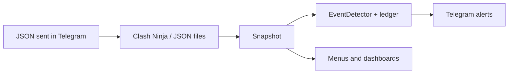

# ⚔️ Clash Ninja Telegram Notifier

> Telegram bot for Clash of Clans upgrade timers and completion notifications across villages.

🌐 **Language / Язык:** [English](README.md) · [Русский](README_RU.md)


## 📌 Overview

The bot tracks upgrade timers for several Clash of Clans accounts (villages), shows them in a Telegram dashboard with a refreshing countdown, and sends a notification the moment an upgrade completes. Data comes either from the Clash Ninja Upgrade Tracker or from the village JSON exports of the game itself, which you can **send straight to the bot in Telegram** — even when the export is huge and Telegram splits it into dozens of messages.

> [!WARNING]
> An empty `authorized_user_ids` list allows any Telegram user who finds the bot to use its menu. Always configure at least your own numeric user ID for a private installation. Sending JSON through Telegram is disabled while the list is empty, because it writes files to disk.

> [!NOTE]
> Only Windows and launching through [start.bat](start.bat) are supported. Builder Base is not tracked.

## ✨ Features

- **Dashboard** for all accounts with a refreshing countdown, a "nearest first" view, per-account view and automatic pagination when the list is longer than one Telegram message.
- **Exact notifications:** an alert arrives when a timer ends, not when fresh data happens to arrive. Finished upgrades and freed helpers share one message.
- **Send the game JSON in Telegram:** paste the export as text (any number of messages, they are reassembled automatically) or send a `.json` file. See [Sending JSON in Telegram](#-sending-json-in-telegram).
- **Accounts screen:** list, replace the JSON, rename, download the stored file, delete (to a trash folder).
- **Stale data warnings** when an export is older than 24 hours, and **source health alerts** (for example an expired Clash Ninja cookie) with a recovery message.
- Per-chat **time zone** and **alerts on/off** switch, manual **refresh** button.
- Two data sources: Clash Ninja (cookie) or local game JSON exports.
- State lives in a local SQLite database with versioned migrations (a backup is made before the schema changes).
- `start.bat` creates `.venv`, installs dependencies, and checks for updates by itself.

## 🏗️ How it works



The monitor fetches data every `poll_interval_seconds`, keeps the newest snapshot, and wakes up exactly when the nearest upgrade ends so the alert is not delayed until the next poll. A ledger in SQLite guarantees each completion is announced once, even across restarts and re-imports. Menus are redrawn every `dashboard_refresh_seconds`, but a message is only edited when its content really changed.

## 🚀 Quick start

### Requirements

- Windows;
- Python **3.14+** (with the Windows Python Launcher present, `start.bat` invokes `py -3.14`; having only a newer Python installed does not guarantee `.venv` can be created);
- a Telegram bot created through [@BotFather](https://t.me/BotFather);
- for the Clash Ninja source: an account with Upgrade Tracker configured.

### Installation

```powershell
git clone https://github.com/soroka01/Clash-Of-Clans-Telegram-Clash-Ninja-notifyer.git
cd Clash-Of-Clans-Telegram-Clash-Ninja-notifyer
```

Or download the [ZIP archive](https://github.com/soroka01/Clash-Of-Clans-Telegram-Clash-Ninja-notifyer/archive/refs/heads/main.zip).

### Configuration

```powershell
Copy-Item config.example.json config.json
```

In `config.json` set the Telegram token, allowed user IDs, notification chats, and `data_source` (`json` or `clash_ninja`). All fields are described below.

### Run

```powershell
.\start.bat
```

Then send `/start` to the bot. The launcher creates a local `.venv`, upgrades `pip`, `setuptools`, and `wheel` inside it, installs `requirements.txt`, and starts `main.py`; global Python packages are not used. Manual launch after the environment is prepared:

```powershell
.\.venv\Scripts\python.exe main.py
```

With `data_source` set to `json`, press **📥 Загрузить JSON** ("Load JSON") in the menu (or send `/import`) and paste your first export.

## 📥 Sending JSON in Telegram

Available when `data_source` is `json` and `authorized_user_ids` is not empty.

1. Export your village from the game (the JSON that starts with `{"tag":"#…`).
2. Send it to the bot in a private chat, either way:
   - **as text** — paste it into the message box and send. A long text is cut by Telegram into messages of up to 4096 characters; the bot collects them, restores their real order by Telegram message id even if they are handled out of order, and joins them. One status message shows the progress;
   - **as a file** — attach the export as a `.json` document (the easiest way for very large exports, and the only way in groups with Privacy Mode on).
3. The bot answers with a summary: the account, its active upgrades and the nearest completion. Your pasted messages are deleted afterwards (switch off with `json_import.delete_messages`).

What happens to the data:

| Case | Result |
| --- | --- |
| New player tag | A new account is created. Its name is taken from `/import Name` (sent right before), the file name, or the tag. A taken name gets a number. |
| Tag already known | The existing account is updated in place and keeps its name. |
| The text stops half way | The bot waits (up to a minute) for the rest, then reports that the JSON is incomplete. |
| Not an export / broken JSON | A clear message tells what is wrong; nothing is saved. |

Notes:

- Names are sanitised (no path separators or reserved Windows names, at most 40 characters). The stored file is rewritten as compact JSON, never copied byte for byte.
- Limits: `json_import.max_megabytes` (5 MB by default, at most 19 because Bot API downloads stop at 20 MB) and 2000 messages per paste.
- In groups Telegram does not deliver plain messages to bots with Privacy Mode on; start with `/import` and send a `.json` file, or turn Privacy Mode off in @BotFather.
- Deleting an account moves its file to `accounts/_trash/`; it is never erased.

## ⚙️ Configuration

Settings are read from `config.json` (template: [config.example.json](config.example.json)).

```json
{
  "bot_token": "PUT_TELEGRAM_BOT_TOKEN_HERE",
  "authorized_user_ids": [123456789],
  "notification_chat_ids": [123456789],
  "poll_interval_seconds": 60,
  "dashboard_refresh_seconds": 10,
  "utc_offset_hours": 5,
  "database_path": "data/clash_ninja_bot.sqlite3",
  "data_source": "json",
  "json_accounts_directory": "accounts",
  "announce_on_timer": true,
  "announce_max_age_hours": 24,
  "failure_alert_threshold": 3,
  "json_import": {
    "max_megabytes": 5,
    "idle_seconds": 3,
    "delete_messages": true
  },
  "clash_ninja": {
    "tracker_url": "https://www.clash.ninja/upgrade-tracker",
    "cookie_header": "PUT_FULL_COOKIE_HEADER_FROM_LOGGED_IN_CLASH_NINJA_HERE",
    "request_timeout_seconds": 30
  }
}
```

| Variable | Default | Description |
| --- | --- | --- |
| `bot_token` | required | Telegram bot token |
| `authorized_user_ids` | required | User IDs allowed to use commands and buttons |
| `notification_chat_ids` | required | Private chats or groups that receive alerts |
| `poll_interval_seconds` | `60` | Source refresh period; minimum 30 |
| `dashboard_refresh_seconds` | `10` | Menu redraw period; minimum 10 |
| `utc_offset_hours` | `0` | Default UTC offset, an integer from `-12` through `14` |
| `database_path` | `data/clash_ninja_bot.sqlite3` | Local SQLite database path |
| `data_source` | `clash_ninja` | `clash_ninja` or `json` |
| `json_accounts_directory` | `accounts` | Folder containing account JSON files |
| `announce_on_timer` | `true` | Alert when a timer ends; if `false`, alerts only follow fresh data |
| `announce_max_age_hours` | `24` | Timers that ended longer ago than this are not announced (stale exports, long downtime) |
| `failure_alert_threshold` | `3` | Consecutive failed refreshes before the owner is alerted; `0` disables |
| `json_import.max_megabytes` | `5` | Largest accepted export, 1–19 |
| `json_import.idle_seconds` | `3` | Pause after the last message before a pasted JSON is considered complete, 1–30 |
| `json_import.delete_messages` | `true` | Delete the pasted messages after a successful import |
| `clash_ninja.tracker_url` | `https://www.clash.ninja/upgrade-tracker` | Upgrade Tracker URL |
| `clash_ninja.cookie_header` | none | Complete HTTP `Cookie` header value |
| `clash_ninja.request_timeout_seconds` | `30` | Request timeout; minimum 5 |

### Commands

| Command | Description |
| --- | --- |
| `/start`, `/menu` | Open the main menu |
| `/status` | Open the all-account dashboard directly |
| `/accounts` | Open the accounts list |
| `/import [name]` | Prepare for a JSON export; the optional name is used for a new account |
| `/cancel` | Cancel an import or a rename in progress |
| `/help` | Show help |

The menu provides current upgrades, accounts, settings (time zone, alerts on/off) and Clash Ninja, Clash of Clans, and GitHub links.

### Clash Ninja source: cookie

1. Sign in to Clash Ninja and open [Upgrade Tracker](https://www.clash.ninja/upgrade-tracker).
2. Press `F12`, open **Network**, and reload the page.
3. Select the successful `upgrade-tracker` request.
4. Under **Headers** → **Request Headers**, copy the complete value after `Cookie:` as one line.
5. Paste it into `clash_ninja.cookie_header`.

If `cookie_header` is empty or still contains the `PUT_...` placeholder, the bot tries to find the cookie in a browser where you are signed in to Clash Ninja (AppData, Windows only); if the browser is open, close it and restart. Cookies expire: after `failure_alert_threshold` failed refreshes the bot sends an alert in Telegram and a recovery message once the session works again.

### JSON source (without Clash Ninja)

```json
{
  "data_source": "json",
  "json_accounts_directory": "accounts"
}
```

Accounts live in `accounts/`, one game export per village. You can send them through Telegram (see above) or copy the files there by hand: the account name is the filename without `.json`, for example `accounts/Greatness.json`. The folder is created automatically and may start empty. Builder Base fields (`buildings2`, `units2`, and other `2`-suffix fields) are ignored. Cookie and website access are not required in this mode.

An export is a snapshot: a timer in it is final, so the bot announces completion when the timer ends. To see upgrades you started later, send a fresh export. An account whose export is older than 24 hours is marked with a warning.

### When you get alerts

- an upgrade timer ended (or the upgrade vanished from fresh data shortly before/after its finish time) — one message per upgrade, with freed helpers merged in;
- a helper became free after a data refresh;
- the data source keeps failing, and when it recovers.

After an update to this version, or on the first start with an old export, timers that are already over are **not** announced (they are older than `announce_max_age_hours` or predate the announcement ledger), so you will not get a burst of stale alerts.

### Automatic updates

`start.bat` checks for updates before launch:

- in a Git clone: `git fetch` followed by `git pull --ff-only`;
- any output from `git status --porcelain`, including untracked files, skips the update;
- without Git, or from an extracted ZIP, the launcher downloads a fresh archive through PowerShell;
- when the network update fails, the installed version still starts.

`config.json`, `.venv`, `data/`, `accounts/`, and `logs/` are preserved. ZIP mode may replace every other project file, so do not keep uncommitted edits in that directory. The database is upgraded automatically and a copy `data/*.bak` is created before the first change.

### Troubleshooting

| Symptom | Check |
| --- | --- |
| Clash Ninja rejects the session | Obtain a new `cookie_header` (the bot also alerts you) |
| The bot ignores commands | `bot_token` and your ID in `authorized_user_ids` |
| No alerts arrive | `notification_chat_ids`, the alerts switch in ⚙️ Settings, bot permissions, and `logs/error.log` |
| "Load JSON" is missing from the menu | `data_source` must be `json` and `authorized_user_ids` must not be empty |
| A pasted JSON is not accepted in a group | Privacy Mode: send `/import` first and attach a `.json` file |
| The dashboard is stale | Source availability and `poll_interval_seconds`; for JSON, send a fresh export |
| An item is shown as `ID 1000123` | The game id is not in `app/domain/game_data.py`; add it (it is logged once) |
| The update is skipped | `git status --short`, including untracked files |
| `.venv` is not created | Python 3.14 is available for `py -3.14` |

## 🗂️ Project structure

```text
.
├── main.py                     # entry point: logging, configuration, Application
├── start.bat                   # launcher: update, .venv, dependencies, run
├── requirements.txt            # aiogram, aiohttp, beautifulsoup4, cryptography
├── config.example.json         # settings template
├── accounts/                   # game JSON exports (local, not in Git)
├── data/                       # SQLite database and its backups (local, not in Git)
├── logs/                       # bot.log, error.log (local, not in Git)
└── app/
    ├── application.py          # composition root: wires and runs everything
    ├── logging_setup.py        # console and rotating file logs
    ├── config/                 # Settings dataclasses and SettingsLoader
    ├── domain/                 # models, events, game id catalog, time formatting
    ├── sources/                # SnapshotSource implementations
    │   ├── clash_ninja/        # client, tracker parser, cookie discovery
    │   └── json_accounts/      # export parser, account file store, source
    ├── storage/                # Database + migrations, repositories, announcement ledger
    ├── services/               # monitor, event detector, source health, accounts, JSON importer
    └── ui/                     # Telegram layer
        ├── gateway.py          # the only code that calls the Bot API
        ├── menu_service.py     # live menu per chat
        ├── notifier.py         # alert delivery
        ├── render/             # screens: dashboard, menus, accounts, import, notifications
        └── handlers/           # navigation, settings, accounts, import
```

## 🔒 Security & privacy

| Path | Contents |
| --- | --- |
| `config.json` | Telegram token and Clash Ninja cookie; excluded from Git |
| `accounts/*.json`, `accounts/_trash/` | Game exports and deleted accounts; excluded from Git |
| `data/clash_ninja_bot.sqlite3` | Last snapshot, menu messages, time zones, announcement ledger |
| `data/*.bak` | Database copies made before a schema upgrade |
| `logs/bot.log` | Detailed rotating log |
| `logs/error.log` | Errors only |

Do not publish these files. Keep `config.json`, `accounts/` and `data/` when moving an installation to preserve settings and saved screens. Only users from `authorized_user_ids` can upload files, and uploads are validated and rewritten before they are stored.

## ⚠️ Limitations

- The parser depends on Clash Ninja's current HTML and feed structure and may need updates when the site changes.
- Time zones are whole-hour UTC offsets and do not follow daylight saving time.
- Game ids are mapped to names through a built-in table; new game objects show up as `ID <number>` until added.
- Only Windows is supported.
- Builder Base is not tracked.

## 📄 License

[MIT](LICENSE).

## 💬 Support

Feel free to [fork this repository](https://github.com/soroka01/Clash-Of-Clans-Telegram-Clash-Ninja-notifyer/fork) and adapt it. If it helped you, leave a [Star](https://github.com/soroka01/Clash-Of-Clans-Telegram-Clash-Ninja-notifyer) so I can see it was useful.

---

with love ❤️
