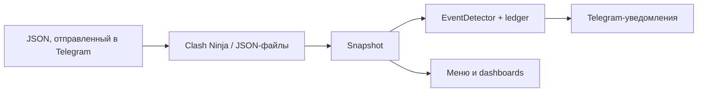

# ⚔️ Clash Ninja Telegram Notifier

> Telegram-бот для отслеживания улучшений Clash of Clans: таймеры по деревням и уведомления о завершении.

🌐 **Язык / Language:** [Русский](README_RU.md) · [English](README.md)


## 📌 Обзор

Бот следит за таймерами улучшений нескольких аккаунтов (деревень) Clash of Clans, показывает их в Telegram-dashboard с обновляемым countdown и присылает уведомление в момент завершения улучшения. Данные берутся либо из Clash Ninja Upgrade Tracker, либо из JSON-экспортов деревни из самой игры, которые можно **отправить прямо боту в Telegram** — даже если экспорт огромный и Telegram разбивает его на десятки сообщений.

> [!WARNING]
> Пустой `authorized_user_ids` означает доступ к меню для любого Telegram-пользователя, который найдёт бота. Для приватной установки всегда указывайте хотя бы свой числовой user ID. Пока список пуст, отправка JSON через Telegram отключена, потому что она записывает файлы на диск.

> [!NOTE]
> Поддерживается только Windows и запуск через [start.bat](start.bat). Builder Base не учитывается.

## ✨ Возможности

- **Dashboard** всех аккаунтов с обновляемым countdown, видом «сначала ближайшие», видом по аккаунту и автоматической разбивкой на страницы, если список длиннее одного сообщения Telegram.
- **Точные уведомления:** оповещение приходит, когда таймер заканчивается, а не когда случайно приходят свежие данные. Завершённые улучшения и освободившиеся помощники объединяются в одно сообщение.
- **Отправка JSON игры прямо в Telegram:** вставьте экспорт текстом (любое число сообщений, они склеиваются автоматически) или отправьте файл `.json`. См. [Отправка JSON в Telegram](#-отправка-json-в-telegram).
- **Экран «👥 Аккаунты»:** список, замена JSON, переименование, скачивание сохранённого файла, удаление (в папку-корзину).
- **Предупреждения об устаревших данных**, если экспорту больше 24 часов, и **оповещения о состоянии источника** (например, истёк cookie Clash Ninja) с сообщением о восстановлении.
- **Часовой пояс** для каждого чата, переключатель **уведомлений** и кнопка ручного **обновления**.
- Два источника данных: Clash Ninja (cookie) или локальные JSON-экспорты игры.
- Состояние хранится в локальной SQLite с версионируемыми миграциями (перед изменением схемы создаётся резервная копия).
- `start.bat` сам создаёт `.venv`, ставит зависимости и проверяет обновления.

## 🏗️ Как это работает



Монитор получает данные каждые `poll_interval_seconds`, хранит самый свежий snapshot и просыпается ровно тогда, когда заканчивается ближайшее улучшение, поэтому уведомление не откладывается до следующего опроса. Ledger в SQLite гарантирует, что каждое завершение объявляется один раз — даже после перезапусков и повторных импортов. Меню перерисовываются каждые `dashboard_refresh_seconds`, но сообщение редактируется, только если его содержимое действительно изменилось.

## 🚀 Быстрый старт

### Требования

- Windows;
- Python **3.14+** (при наличии Windows Python Launcher `start.bat` вызывает `py -3.14`; одной лишь более новой версии для создания `.venv` недостаточно);
- Telegram-бот от [@BotFather](https://t.me/BotFather);
- для источника Clash Ninja: аккаунт с заполненным Upgrade Tracker.

### Установка

```powershell
git clone https://github.com/soroka01/Clash-Of-Clans-Telegram-Clash-Ninja-notifyer.git
cd Clash-Of-Clans-Telegram-Clash-Ninja-notifyer
```

Либо скачайте [ZIP-архив](https://github.com/soroka01/Clash-Of-Clans-Telegram-Clash-Ninja-notifyer/archive/refs/heads/main.zip).

### Настройка

```powershell
Copy-Item config.example.json config.json
```

Укажите в `config.json` Telegram token, разрешённые user ID, чаты для уведомлений и `data_source` (`json` или `clash_ninja`). Все поля описаны ниже.

### Запуск

```powershell
.\start.bat
```

Затем отправьте боту `/start`. Launcher создаёт локальную `.venv`, обновляет в ней `pip`, `setuptools` и `wheel`, ставит `requirements.txt` и запускает `main.py`; глобальные пакеты не используются. Ручной запуск после подготовки окружения:

```powershell
.\.venv\Scripts\python.exe main.py
```

Если `data_source` равен `json`, нажмите в меню **📥 Загрузить JSON** (или отправьте `/import`) и вставьте свой первый экспорт.

## 📥 Отправка JSON в Telegram

Доступно, когда `data_source` равен `json`, а `authorized_user_ids` не пуст.

1. Экспортируйте деревню из игры (JSON, который начинается с `{"tag":"#…`).
2. Отправьте его боту в личном чате любым из способов:
   - **текстом** — вставьте в поле сообщения и отправьте. Длинный текст Telegram режет на сообщения до 4096 символов; бот собирает их, восстанавливает настоящий порядок по id сообщений Telegram, даже если они обработаны не по порядку, и склеивает. Прогресс показывает одно статусное сообщение;
   - **файлом** — приложите экспорт как документ `.json` (самый простой способ для очень больших экспортов и единственный — в группах с включённым Privacy Mode).
3. Бот отвечает сводкой: аккаунт, его активные улучшения и ближайшее завершение. Вставленные вами сообщения после этого удаляются (отключается через `json_import.delete_messages`).

Что происходит с данными:

| Случай | Результат |
| --- | --- |
| Новый тег игрока | Создаётся новый аккаунт. Имя берётся из `/import Имя` (отправленного перед этим), из имени файла или из тега. Занятое имя получает номер. |
| Тег уже известен | Существующий аккаунт обновляется на месте и сохраняет своё имя. |
| Текст оборвался на середине | Бот ждёт остаток (до минуты), затем сообщает, что JSON неполный. |
| Это не экспорт / битый JSON | Понятное сообщение объясняет, что не так; ничего не сохраняется. |

Примечания:

- Имена очищаются (без разделителей путей и зарезервированных имён Windows, не длиннее 40 символов). Сохранённый файл переписывается как компактный JSON и никогда не копируется побайтово.
- Лимиты: `json_import.max_megabytes` (по умолчанию 5 МБ, не больше 19, потому что загрузки через Bot API ограничены 20 МБ) и 2000 сообщений за одну вставку.
- В группах при включённом Privacy Mode Telegram не доставляет боту обычные сообщения; начните с `/import` и отправьте файл `.json` либо отключите Privacy Mode в @BotFather.
- Удаление аккаунта переносит его файл в `accounts/_trash/`; файл никогда не стирается.

## ⚙️ Конфигурация

Настройки читаются из `config.json` (шаблон — [config.example.json](config.example.json)).

```json
{
  "bot_token": "PUT_TELEGRAM_BOT_TOKEN_HERE",
  "authorized_user_ids": [123456789],
  "notification_chat_ids": [123456789],
  "poll_interval_seconds": 60,
  "dashboard_refresh_seconds": 10,
  "utc_offset_hours": 5,
  "database_path": "data/clash_ninja_bot.sqlite3",
  "data_source": "json",
  "json_accounts_directory": "accounts",
  "announce_on_timer": true,
  "announce_max_age_hours": 24,
  "failure_alert_threshold": 3,
  "json_import": {
    "max_megabytes": 5,
    "idle_seconds": 3,
    "delete_messages": true
  },
  "clash_ninja": {
    "tracker_url": "https://www.clash.ninja/upgrade-tracker",
    "cookie_header": "PUT_FULL_COOKIE_HEADER_FROM_LOGGED_IN_CLASH_NINJA_HERE",
    "request_timeout_seconds": 30
  }
}
```

| Переменная | По умолчанию | Описание |
| --- | --- | --- |
| `bot_token` | обязательно | Token Telegram-бота |
| `authorized_user_ids` | обязательно | User ID, которым разрешены команды и кнопки |
| `notification_chat_ids` | обязательно | Личные чаты или группы, получающие уведомления |
| `poll_interval_seconds` | `60` | Период обновления источника; минимум 30 |
| `dashboard_refresh_seconds` | `10` | Период перерисовки меню; минимум 10 |
| `utc_offset_hours` | `0` | UTC по умолчанию, целое число от `-12` до `14` |
| `database_path` | `data/clash_ninja_bot.sqlite3` | Путь к локальной SQLite-базе |
| `data_source` | `clash_ninja` | `clash_ninja` или `json` |
| `json_accounts_directory` | `accounts` | Папка с JSON-файлами аккаунтов |
| `announce_on_timer` | `true` | Уведомлять, когда таймер закончился; при `false` уведомления идут только вслед за свежими данными |
| `announce_max_age_hours` | `24` | Таймеры, закончившиеся раньше этого срока, не объявляются (устаревшие экспорты, долгий простой) |
| `failure_alert_threshold` | `3` | Число неудачных обновлений подряд, после которого владельцу приходит оповещение; `0` отключает |
| `json_import.max_megabytes` | `5` | Максимальный размер принимаемого экспорта, 1–19 |
| `json_import.idle_seconds` | `3` | Пауза после последнего сообщения, после которой вставленный JSON считается полным, 1–30 |
| `json_import.delete_messages` | `true` | Удалять вставленные сообщения после успешного импорта |
| `clash_ninja.tracker_url` | `https://www.clash.ninja/upgrade-tracker` | URL Upgrade Tracker |
| `clash_ninja.cookie_header` | нет | Полное значение HTTP-заголовка `Cookie` |
| `clash_ninja.request_timeout_seconds` | `30` | Timeout запроса; минимум 5 |

### Команды

| Команда | Описание |
| --- | --- |
| `/start`, `/menu` | Открыть главное меню |
| `/status` | Сразу открыть dashboard всех аккаунтов |
| `/accounts` | Открыть список аккаунтов |
| `/import [имя]` | Подготовиться к загрузке JSON-экспорта; необязательное имя используется для нового аккаунта |
| `/cancel` | Отменить загрузку или переименование |
| `/help` | Показать справку |

В меню доступны «📋 Текущие улучшения», «👥 Аккаунты», «⚙️ Настройки» (часовой пояс, уведомления вкл/выкл) и ссылки на Clash Ninja, Clash of Clans и GitHub.

### Источник Clash Ninja: cookie

1. Войдите в Clash Ninja и откройте [Upgrade Tracker](https://www.clash.ninja/upgrade-tracker).
2. Нажмите `F12`, откройте **Network** и обновите страницу.
3. Выберите успешный запрос `upgrade-tracker`.
4. В **Headers** → **Request Headers** скопируйте всё значение после `Cookie:` в одну строку.
5. Вставьте его в `clash_ninja.cookie_header`.

Если `cookie_header` пуст или содержит заглушку `PUT_...`, бот пытается найти cookie в браузере, где вы вошли в Clash Ninja (AppData, только Windows); если браузер открыт, закройте его и повторите запуск. Cookie имеет срок действия: после `failure_alert_threshold` неудачных обновлений подряд бот присылает оповещение в Telegram, а когда сессия снова работает — сообщение о восстановлении.

### Источник JSON (без Clash Ninja)

```json
{
  "data_source": "json",
  "json_accounts_directory": "accounts"
}
```

Аккаунты лежат в `accounts/`, по одному экспорту игры на деревню. Их можно отправить через Telegram (см. выше) или скопировать файлы туда вручную: ником считается имя файла без `.json`, например `accounts/Greatness.json`. Папка создаётся автоматически и может быть пустой. Builder Base (`buildings2`, `units2` и другие поля с суффиксом `2`) не учитывается. Cookie и доступ к сайту в этом режиме не нужны.

Экспорт — это снимок: таймер в нём окончательный, поэтому бот объявляет завершение, когда таймер заканчивается. Чтобы увидеть улучшения, начатые позже, отправьте свежий экспорт. Аккаунт, экспорту которого больше 24 часов, помечается предупреждением.

### Когда приходят уведомления

- закончился таймер улучшения (или улучшение исчезло из свежих данных незадолго до или после времени завершения) — одно сообщение на улучшение, с объединёнными освободившимися помощниками;
- после обновления данных освободился помощник;
- источник данных постоянно даёт сбой, и когда он восстановился.

После обновления до этой версии, а также при первом запуске со старым экспортом уже закончившиеся таймеры **не объявляются** (они старше `announce_max_age_hours` или появились раньше ledger уведомлений), поэтому поток устаревших уведомлений вам не придёт.

### Автообновление

`start.bat` проверяет обновления перед запуском:

- в Git-клоне: `git fetch` и `git pull --ff-only`;
- любые записи в `git status --porcelain`, включая untracked-файлы, пропускают update;
- без Git или в распакованном ZIP launcher скачивает свежий архив через PowerShell;
- при ошибке сети запускается уже установленная версия.

Сохраняются `config.json`, `.venv`, `data/`, `accounts/` и `logs/`. ZIP-режим может заменить остальные файлы проекта, поэтому не храните в его каталоге несохранённые правки. База данных обновляется автоматически, а перед первым изменением создаётся копия `data/*.bak`.

### Решение проблем

| Симптом | Что проверить |
| --- | --- |
| Clash Ninja отклонил сессию | Получите новый `cookie_header` (бот тоже пришлёт оповещение) |
| Бот игнорирует команды | `bot_token` и свой ID в `authorized_user_ids` |
| Нет уведомлений | `notification_chat_ids`, переключатель уведомлений в «⚙️ Настройки», права бота и `logs/error.log` |
| В меню нет «📥 Загрузить JSON» | `data_source` должен быть `json`, а `authorized_user_ids` не должен быть пустым |
| Вставленный JSON не принимается в группе | Privacy Mode: сначала отправьте `/import` и приложите файл `.json` |
| Dashboard показывает старые данные | Доступность источника и `poll_interval_seconds`; для JSON отправьте свежий экспорт |
| Элемент показан как `ID 1000123` | Игрового id нет в `app/domain/game_data.py`; добавьте его (в лог это попадает один раз) |
| Update пропущен | `git status --short`, включая untracked-файлы |
| Не создаётся `.venv` | Наличие именно Python 3.14 для `py -3.14` |

## 🗂️ Структура проекта

```text
.
├── main.py                     # точка входа: логирование, конфигурация, Application
├── start.bat                   # launcher: обновление, .venv, зависимости, запуск
├── requirements.txt            # aiogram, aiohttp, beautifulsoup4, cryptography
├── config.example.json         # шаблон настроек
├── accounts/                   # JSON-экспорты игры (локально, не в Git)
├── data/                       # SQLite-база и её резервные копии (локально, не в Git)
├── logs/                       # bot.log, error.log (локально, не в Git)
└── app/
    ├── application.py          # composition root: связывает и запускает всё
    ├── logging_setup.py        # логи в консоль и в ротируемые файлы
    ├── config/                 # dataclasses Settings и SettingsLoader
    ├── domain/                 # модели, события, каталог игровых id, форматирование времени
    ├── sources/                # реализации SnapshotSource
    │   ├── clash_ninja/        # клиент, парсер трекера, поиск cookie
    │   └── json_accounts/      # парсер экспорта, хранилище файлов аккаунтов, источник
    ├── storage/                # Database + миграции, репозитории, ledger уведомлений
    ├── services/               # монитор, event detector, состояние источника, аккаунты, JSON-импорт
    └── ui/                     # слой Telegram
        ├── gateway.py          # единственный код, обращающийся к Bot API
        ├── menu_service.py     # живое меню для каждого чата
        ├── notifier.py         # доставка уведомлений
        ├── render/             # экраны: dashboard, меню, аккаунты, импорт, уведомления
        └── handlers/           # навигация, настройки, аккаунты, импорт
```

## 🔒 Безопасность и приватность

| Путь | Содержимое |
| --- | --- |
| `config.json` | Telegram token и Clash Ninja cookie; исключён из Git |
| `accounts/*.json`, `accounts/_trash/` | Экспорты игры и удалённые аккаунты; исключены из Git |
| `data/clash_ninja_bot.sqlite3` | Последний snapshot, сообщения меню, часовые пояса, ledger уведомлений |
| `data/*.bak` | Копии базы, сделанные перед обновлением схемы |
| `logs/bot.log` | Подробный rotating log |
| `logs/error.log` | Только ошибки |

Не публикуйте эти файлы. Сохраняйте `config.json`, `accounts/` и `data/`, чтобы перенести установку без потери настроек и сохранённых экранов. Загружать файлы могут только пользователи из `authorized_user_ids`, а загруженное проверяется и переписывается перед сохранением.

## ⚠️ Ограничения

- Парсер зависит от текущей HTML/feed-структуры Clash Ninja и может потребовать обновления после изменений сайта.
- Часовые пояса — целые смещения UTC, переход на летнее время не учитывается.
- Игровые id сопоставляются с названиями по встроенной таблице; новые игровые объекты показываются как `ID <число>`, пока их не добавят.
- Поддерживается только Windows.
- Builder Base не учитывается.

## 📄 Лицензия

[MIT](LICENSE).

## 💬 Поддержка

Можно [форкнуть репозиторий](https://github.com/soroka01/Clash-Of-Clans-Telegram-Clash-Ninja-notifyer/fork) и доработать под себя. Если проект пригодился, поставьте [Star](https://github.com/soroka01/Clash-Of-Clans-Telegram-Clash-Ninja-notifyer) — так я увижу, что он был кому-то полезен.

---

with love ❤️
